 

## 👨‍💻 About Me

> I'm a **DevOps Engineer (fresher)** who learns by building. My projects take an application from **`git push`** to a **scanned, containerized, deployed and monitored** service, using real tools instead of tutorials alone.

| 🔐 **8** | ⚙️ **11** | 🏗 **Day 68** | 🔥 **100+** |
|:---:|:---:|:---:|:---:|
| DevSecOps workflows in one project | reusable Actions workflows built | of hands-on Terraform on AWS | commits in the 90DaysOfDevOps challenge |

## 🧭 How I Ship

```mermaid
flowchart LR
    A([💻 Code]) --> B[⚙️ GitHub Actions CI]
    B --> C[🛡 Trivy · Secret · Dependency Scan]
    C --> D[🐳 Docker Build & Push]
    D --> E[🏗 Terraform · AWS]
    E --> F[☸️ Kubernetes]
    F --> G([📈 Prometheus · Grafana])
    style A fill:#1e293b,stroke:#22d3ee,color:#fff
    style G fill:#1e293b,stroke:#34d399,color:#fff
    style B fill:#0f172a,stroke:#8b5cf6,color:#fff
    style C fill:#0f172a,stroke:#f59e0b,color:#fff
    style D fill:#0f172a,stroke:#2496ed,color:#fff
    style E fill:#0f172a,stroke:#7b42bc,color:#fff
    style F fill:#0f172a,stroke:#326ce5,color:#fff
```

## ⭐ Featured Projects

<table>
<tr>
<td width="50%" valign="top">

### 🚀 [SkillPulse CI/CD & Kubernetes](https://github.com/sumit9165/devops-hackathon-project-tws-batch-10)
A Go + nginx + MySQL app taken from commit to running deployment, fully automated.

- GitHub Actions: `ci`, `cd`, `cd-k8s`
- **Terraform** infrastructure workflow
- **Kubernetes** manifests on `kind`
- **Prometheus** ServiceMonitor + **Grafana**
- Docker Secrets, `Makefile`

</td>
<td width="50%" valign="top">

### 🏗 [Terraform on AWS: Basic to Advanced](https://github.com/sumit9165/terraform-basic-to-advanced-aws-provider)
An 8-day infrastructure-as-code journey, from first resource to EKS.

- VPC, subnets, security groups
- Variables, outputs, data sources
- **Modules** and **remote state backends**
- **Multi-environment** deployments
- Workspaces, dynamic blocks, lifecycle rules

</td>
</tr>
<tr>
<td width="50%" valign="top">

### 🔐 [Authentication_App: DevSecOps](https://github.com/sumit9165/Authentication_App)
A Django auth system with role-based signup and email activation, protected by a security-first pipeline.

- **8 workflows**: code quality, dependency scan, secret scan, Docker lint, image scan, build & push, deploy
- Docker Compose, `SECURITY.md`

</td>
<td width="50%" valign="top">

### 🐳 [Todotask-app: Containerized Two-Tier App](https://github.com/sumit9165/Todotask-app)
A Flask + MySQL app containerized end to end, with **80+ commits** of iteration.

- `Dockerfile` and **multi-stage build**
- `docker-compose.yml`
- Manual run with custom networks and volumes

</td>
</tr>
<tr>
<td width="50%" valign="top">

### 🏦 [AI-BankApp-DevOps](https://github.com/sumit9165/AI-BankApp-DevOps) *(fork)*
A Spring Boot banking app used as an end-to-end DevOps project: Docker, CI/CD, Kubernetes, Helm, Terraform, monitoring and GitOps. Forked from [TrainWithShubham](https://github.com/TrainWithShubham/AI-BankApp-DevOps), with branches `aws`, `feat/gitops` and `feat/kind`.

</td>
<td width="50%" valign="top">

### 🗓 [90 Days of DevOps Journal](https://github.com/sumit9165/90Days-Of-DevOps-with-TWS)
My daily learning log, built around debugging, not just setup.

- Networking notes and a **log analyzer**
- Kubernetes guide
- **Create-and-troubleshoot** scenarios

</td>
</tr>
</table>

## 🛠 Tech Stack

 

 

| | |
|---|---|
| ✅ **Hands-on** | Docker & Compose · GitHub Actions · Terraform (AWS) · Kubernetes (`kind`) · Linux · Git/GitHub · Bash · Python |
| 🔐 **DevSecOps** | Trivy image scanning · dependency & secret scanning · Docker lint · Docker Secrets |
| 📚 **Learning** | Helm · GitOps / ArgoCD · Ansible · deeper observability |

## 📂 More Work

<b>⚙️ CI/CD & GitHub Actions practice</b>

 

| Repository | Focus |
|---|---|
| [workflow-actions](https://github.com/sumit9165/workflow-actions) | 11 workflows: reusable workflows, composite action, scheduled jobs, PR checks, path filters, deploy-after-tests |
| [github-actions-advanced](https://github.com/sumit9165/github-actions-advanced) | DevSecOps pipeline with **Trivy** image scanning (42 commits) |
| [github-actions-runner](https://github.com/sumit9165/github-actions-runner) | **Self-hosted runners** with Docker and tests (37 commits) |
| [demo-oidc](https://github.com/sumit9165/demo-oidc) | **AWS OIDC** from GitHub Actions, with no long-lived keys |

<b>🐳 Docker & containers</b>

 

| Repository | Focus |
|---|---|
| [Go-app-multistage](https://github.com/sumit9165/Go-app-multistage) | Single-stage vs multi-stage vs **non-root** Dockerfiles |
| [flask-redis-postgres-docker-compose-app](https://github.com/sumit9165/flask-redis-postgres-docker-compose-app) | Flask + Redis + PostgreSQL with Compose |
| [nginx-docker-compose-static-site](https://github.com/sumit9165/nginx-docker-compose-static-site) | Static site served by nginx in Compose |
| [wordpress-mysql-docker-compose](https://github.com/sumit9165/wordpress-mysql-docker-compose) | WordPress + MySQL multi-container deployment |

<b>🧑‍💻 Application development</b>

 

| Repository | Focus |
|---|---|
| [bookvault](https://github.com/sumit9165/bookvault) | Spring Boot 3.2 · MySQL/MariaDB · Redis · Thymeleaf · Docker |
| [blogforge-apps](https://github.com/sumit9165/blogforge-apps) | Blog app with CRUD, Vite + MySQL, Compose for dev and prod |
| [bookreview-django](https://github.com/sumit9165/bookreview-django) | Django book management with CRUD and search |

<b>🤝 Open-source contributions</b>

 

| Repository | Upstream | My work |
|---|---|---|
| [90DaysOfDevOps](https://github.com/sumit9165/90DaysOfDevOps) | [TrainWithShubham/90DaysOfDevOps](https://github.com/TrainWithShubham/90DaysOfDevOps) | 100+ commits completing the daily challenge |
| [java-app-full-devops](https://github.com/sumit9165/java-app-full-devops) | [nandini3630/java-app-full-devops](https://github.com/nandini3630/java-app-full-devops) | Added `.gitignore` and `.dockerignore` |

🦈 **Pull Shark** achievement for merged pull requests

## 📊 GitHub Activity

 

## 🎯 Currently

- 🔄 Completing **90 Days of DevOps**
- ☸️ Going deeper on Kubernetes, Helm and GitOps
- ☁️ Building an end-to-end cloud DevOps project on AWS

## 📫 Let's Connect

**Looking for a DevOps Engineer fresher role where I can contribute, learn from experienced teams and grow.**

